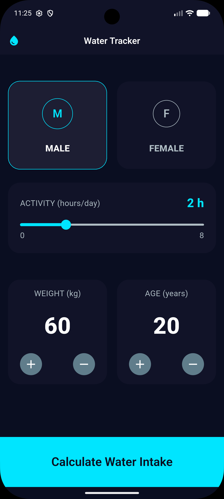
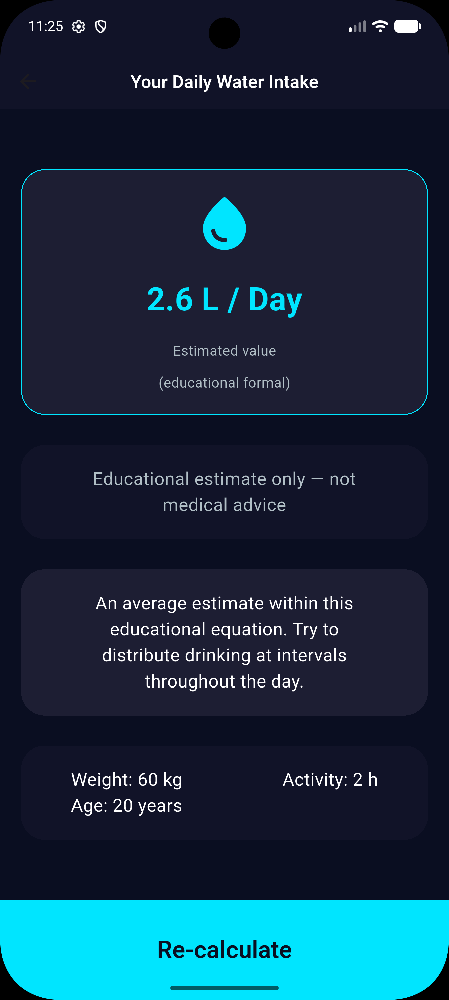

<h1 align="center">💧 Water Hydration Tracker</h1>

<p align="center">
  A simple Flutter app to track your daily water intake and build a healthy hydration habit.
</p>

<p align="center">
  
  
  
</p>

---

## 📖 About

**Water Hydration Tracker** helps you stay on top of how much water you drink every day. Set a daily goal, log each glass, and see your progress at a glance.

## ✨ Features

- 🎯 Set and follow a daily water intake goal
- ➕ Quickly log the water you drink
- 📊 See your progress for the day
- 📱 Cross-platform: Android, iOS, Web, Windows, macOS, and Linux

## 📸 Screenshots

<!--
<p align="center">
  
  
</p> -->

|             Home              |              Result               |
| :---------------------------: | :-------------------------------: |
|  |  |

## 🛠️ Tech Stack

- [Flutter](https://flutter.dev/) (Dart SDK `^3.13.5`)
- Material Design
- `cupertino_icons`

## 🚀 Getting Started

### Prerequisites

- [Flutter SDK](https://docs.flutter.dev/get-started/install) installed
- An emulator, a physical device, or a browser to run the app

### Installation

```bash
# 1. Clone the repository
git clone https://github.com/Ziad-Yaseen/-App-Tracker-Hydration-Water-Daily-.git

# 2. Go to the project folder
cd -App-Tracker-Hydration-Water-Daily-

# 3. Install dependencies
flutter pub get

# 4. Run the app
flutter run
```

### Build

```bash
flutter build apk      # Android
flutter build ios      # iOS
flutter build web      # Web
```

## 📁 Project Structure

```
.
├── lib/          # Dart source code
├── test/         # Tests
├── android/      # Android platform files
├── ios/          # iOS platform files
├── web/          # Web platform files
├── windows/      # Windows platform files
├── macos/        # macOS platform files
├── linux/        # Linux platform files
└── pubspec.yaml  # Dependencies and project config
```

## 🗺️ Roadmap

- [ ] Persistent storage for daily history
- [ ] Reminder notifications
- [ ] Weekly and monthly statistics
- [ ] Dark mode

## 🤝 Contributing

Contributions, issues, and feature requests are welcome! Feel free to open an issue or submit a pull request.

## 👤 Author

**Ziad Yaseen**

- GitHub: [@Ziad-Yaseen](https://github.com/Ziad-Yaseen)
