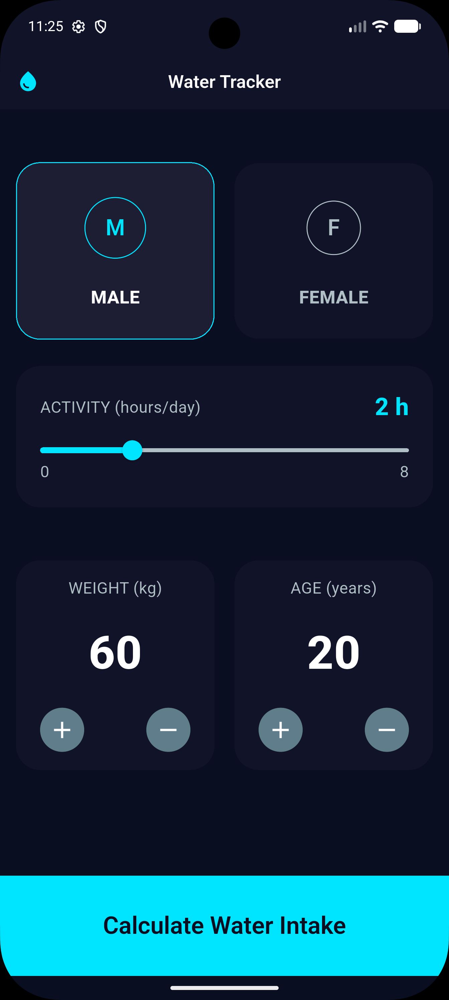
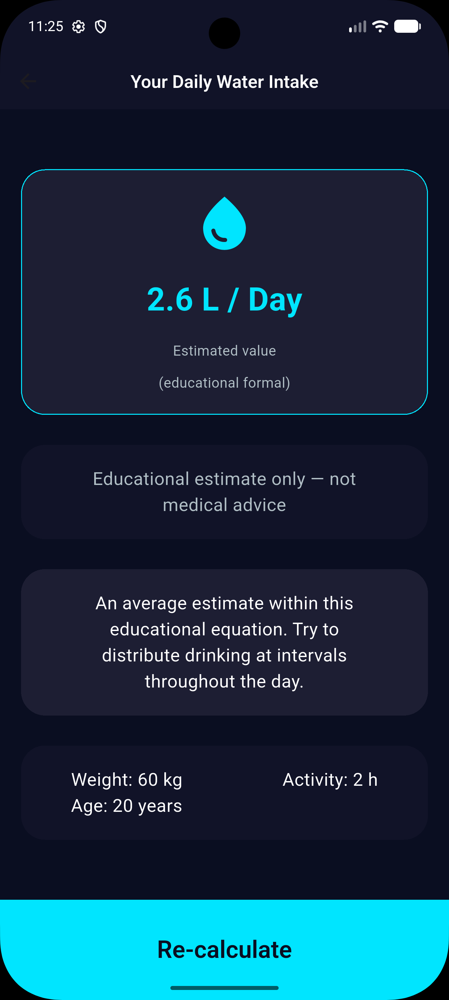

<h1 align="center">💧 Water Hydration Tracker</h1>

<p align="center">
  A clean Flutter app that estimates your daily water intake from your weight and activity level.
</p>

<p align="center">


</p>

---

## 📖 About

**Water Hydration Tracker** asks for a few simple inputs and tells you roughly how many litres of water you should drink per day, along with short guidance based on the result.

> ⚠️ The result is an **educational estimate only** and is not medical advice. Real needs vary from person to person.

## ✨ Features

- 🧮 Instant daily water estimate in litres
- 🚻 Gender selection
- 🏃 Activity slider (0–8 hours/day)
- ⚖️ Weight (30–200 kg) and age (10–100 years) counters
- 💬 Guidance message based on the estimate level (low / average / high)
- ⚠️ Validation: a message appears if no gender is selected
- 🌙 Dark theme (Material 3)
- 📱 Cross-platform: Android, iOS, Web, Windows, macOS, and Linux

## 📸 Screenshots

|             Home              |              Result               |
| :---------------------------: | :-------------------------------: |
|  |  |

## 🧪 How the Estimate Works

```
litres = (weight_kg × 35 ml + activity_hours × 250 ml) / 1000
```

| Result       | Level   |
| :----------- | :------ |
| < 2 L        | Low     |
| 2 – 3 L      | Average |
| > 3 L        | High    |

> Age and gender are collected in the UI but do not affect the formula yet (see the [Roadmap](#️-roadmap)).

## 🛠️ Tech Stack

- [Flutter](https://flutter.dev/) (Dart SDK `^3.13.5`)
- [flutter_bloc](https://pub.dev/packages/flutter_bloc) (Cubit) for state management
- [equatable](https://pub.dev/packages/equatable) for value equality
- Material 3

## 🏗️ Architecture

The project is organized **feature-first**, with shared code in `core/`.

- **State:** a single immutable `WaterState` (`Equatable`) that exposes `litres` and `level` as getters.
- **Cubit:** `WaterCubit` holds state logic only (increment/decrement with limits, gender, activity). No UI text.
- **UI:** each section uses `BlocSelector`, so it rebuilds only when its own value changes.
- **Reusable widgets:** `AppCard`, `CounterCard`, `BottomButton`, `CustomSnackBar`.

## 📁 Project Structure

```
lib/
├── main.dart
├── app.dart
├── core/
│   ├── components/     # AppCard, CounterCard, BottomButton, CustomSnackBar
│   ├── constants/      # AppColors
│   ├── helpers/        # WaterCalc
│   └── styles/         # AppTheme
└── features/
    ├── home/
    │   ├── models/     # GenderType, HydrationLevel
    │   ├── cubit/      # WaterCubit, WaterState
    │   ├── screens/    # HomeView
    │   └── widgets/    # GenderRow, ActivitySlider, AgeWeightRow
    └── result/
        ├── screens/    # ResultView
        └── widgets/    # HydrationWidget, GuidanceWidget, JustEducation, UserInfos
```

## 🚀 Getting Started

### Prerequisites

- [Flutter SDK](https://docs.flutter.dev/get-started/install) installed
- An emulator, a physical device, or a browser to run the app

### Installation

```bash
# 1. Clone the repository
git clone https://github.com/Ziad-Yaseen/-App-Tracker-Hydration-Water-Daily-.git

# 2. Go to the project folder
cd -App-Tracker-Hydration-Water-Daily-

# 3. Install dependencies
flutter pub get

# 4. Run the app
flutter run
```

### Build

```bash
flutter build apk      # Android
flutter build ios      # iOS
flutter build web      # Web
```

## 🗺️ Roadmap

- [ ] Use age and gender in the formula
- [ ] Unit tests for `WaterCalc` and `WaterCubit`
- [ ] Log daily water intake with persistent history
- [ ] Reminder notifications
- [ ] Weekly and monthly statistics
- [ ] Light theme and localization (Arabic)

## 🤝 Contributing

Contributions, issues, and feature requests are welcome! Feel free to open an issue or submit a pull request.

## 👤 Author

**Ziad Yaseen**

- GitHub: [@Ziad-Yaseen](https://github.com/Ziad-Yaseen)